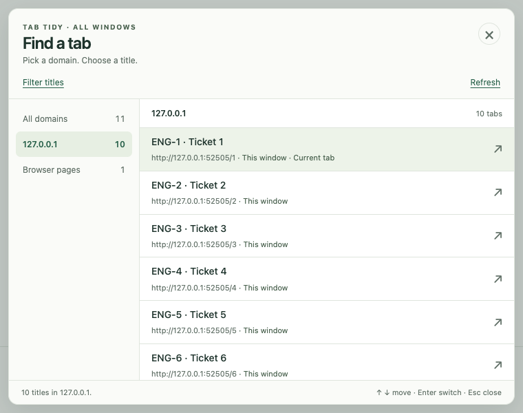
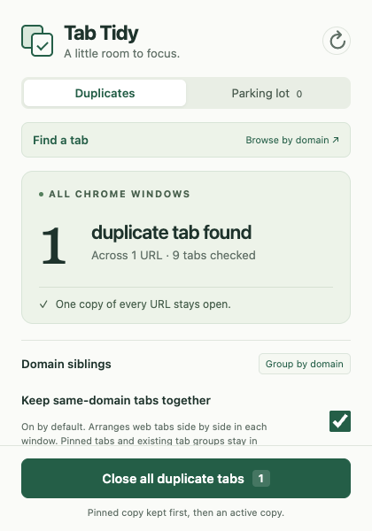
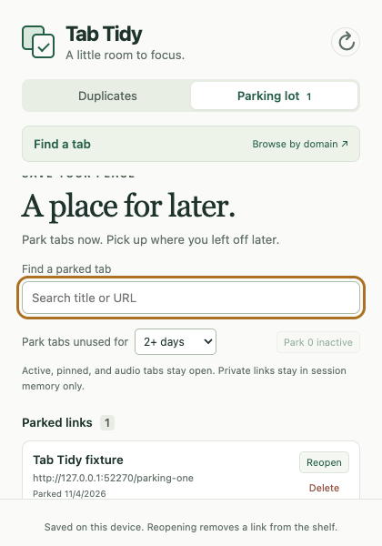

# Tab Tidy

**Find the tab you need. Close duplicate copies. Save the rest for later.**

Tab Tidy is a lightweight Chrome extension for managing tabs across all your windows. Browse by domain, search page titles and URLs, clean up duplicates, and park inactive tabs in a searchable list.

**Chrome 127+ · No build required · Local processing · Personal, noncommercial use**



*Preview with demo tabs and a selected domain. The finder opens with All domains selected and search focused.*

## Features

- **Find any tab:** browse domains or search titles, URLs, and ticket IDs across windows. Long titles wrap, and results update as tabs change.
- **Keyboard navigation:** open search with a shortcut, press ↓ to enter results, then Enter to switch tabs. Focused results have a visible outline and highlight.
- **Duplicate cleanup:** close one extra copy, a whole duplicate group, or all duplicates. Keep one copy of each URL.
- **Undo:** reopen tabs closed by the most recent cleanup, restoring their window, order, and pinned state where possible.
- **Duplicate Shield:** optionally prevent newly opened duplicate web tabs by switching to the existing copy.
- **Domain grouping:** keep tabs from the same hostname beside each other within each window, automatically or on demand.
- **Parking lot:** save inactive tabs as links, then search, reopen, or delete them later.
- **Toolbar badge:** see the number of extra duplicate tabs without opening the popup.

## Previews

| Duplicate cleanup | Parking lot |
| --- | --- |
|  |  |

*Screenshots use local demo pages.*

## Install

1. Download this repository using **Code → Download ZIP**, then extract it; or clone it with Git.
2. Open `chrome://extensions` in Chrome 127 or newer.
3. Turn on **Developer mode**.
4. Choose **Load unpacked** and select the folder containing `manifest.json`.
5. Pin **Tab Tidy** from Chrome’s extensions menu.

No dependency installation or build step is needed to use the extension. Keep the extracted folder in place while it is installed.

To update, replace the source files and click **Reload** on Tab Tidy’s card at `chrome://extensions`.

## Find and switch tabs

Click **Find a tab**, or use the shortcut below. Search starts focused and covers **All domains**. Choose a domain to narrow the results; clear the search to browse every tab in that domain.

| Key | Action |
| --- | --- |
| **⌘⇧K** on macOS / **Ctrl+Shift+K** on Windows and Linux | Open the finder |
| **↓** from search | Focus the first result, including a single match |
| **↑ / ↓** in results | Move between results |
| **Home / End** in results | Focus the first / last result |
| **Enter** on a result | Switch to that tab and focus its window |
| **↑ / ↓**, **Home / End** in the domain sidebar | Select a domain |
| **Tab / Shift+Tab** | Move between controls |
| **Esc** | Close the finder |

Customize **Open domain search** at `chrome://extensions/shortcuts`, using **In Chrome** scope. If the default shortcut conflicts with another command, assign an available combination.

The finder shows full titles, URLs, window labels, and current-tab, private, pinned, audio, and loading indicators. Switching tabs does not navigate, reload, or close them. Subdomains remain separate; browser pages and local files have their own categories.

## Clean up duplicates

The duplicate count means **extra copies**: three tabs with the same URL count as two duplicates.

- **Close** removes an individual copy.
- **Close N** removes a URL group’s extra copies.
- **Close all duplicate tabs** removes all listed extras.
- **Undo last cleanup** reopens tabs from the most recent cleanup. A later cleanup replaces that recovery set; a cleanup that closes nothing preserves it.

Exact URL matching is the default. Enable **Ignore tracking parameters** to also match HTTP(S) URLs that differ only by `utm_*`, `gclid`, `dclid`, `fbclid`, `msclkid`, `mc_cid`, `mc_eid`, `_ga`, or `_gl`. Other parameters, their order and encoding, paths, protocols, and fragments remain significant. Original URLs are retained for Undo.

One copy remains per URL: a pinned copy is preferred, then an active copy, then the lowest tab ID. Multiple pinned copies may still be deduplicated. Tabs with pending navigation are skipped. Regular and private tabs are never combined; private browsing requires enabling the extension’s incognito access in Chrome.

**Undo restores links, not page state.** Reopened tabs load again; history, unsaved edits, scroll positions, and tab groups are not restored. Recovery survives closing the popup, but clears on browser restart or extension reload, disable, or update. Failed restores remain available to retry. Closing the last tab in a window can close that window.

## Duplicate Shield

Shield is **off by default**. Enable it to catch newly opened HTTP(S) duplicates, switch to an existing copy, and close the new extra tab. It follows your exact or tracking-parameter matching preference.

Shield watches a new tab’s initial navigation, including redirects, until the first page finishes loading or 30 seconds pass. Ordinary navigation in existing tabs is left alone. Newly pinned, audible, and discarded tabs are skipped. Intentional Undo and parking-lot reopens bypass Shield during initial navigation.

## Group tabs by domain

**Group by domain** places tabs with the same hostname next to each other within each window, preserving their relative order. Different subdomains remain separate; HTTP and HTTPS pages with the same hostname are siblings.

**Keep same-domain tabs together** is on by default and remembered on this device. Turn it off to arrange tabs manually. Automatic grouping runs on tab events and browser startup or extension installation/update; manual dragging is left alone until a later tab event.

Pinned tabs, existing Chrome tab groups, internal pages, and pending navigations form boundaries. Grouping moves ordinary web tabs within those boundaries without closing or reloading them.

## Park tabs for later

Open **Parking lot**, choose an inactivity cutoff, then click **Park inactive**. The default is **2+ days**; options also include 24+ hours and any currently inactive tab.

Active tabs in each window, pinned tabs, playing audio, pending navigations, and non-HTTP(S) pages stay open. Each link is saved before its tab closes. You can also park an individual tab under **Open tabs you can park**.

- Search saved links by title or URL.
- **Reopen** opens the original URL or focuses an existing exact-URL copy, then removes the saved entry.
- **Delete** removes only the saved link.
- Repeated exact URLs share one saved entry.

Normal parked links stay on this device until reopened, deleted, or the extension is uninstalled. Private parked links remain only in session storage and disappear on browser restart or extension reload, disable, or update. Parking saves links, not history or unsaved page state, and does not replace cleanup Undo.

## Privacy and permissions

Tab Tidy processes tab information locally. It has no content scripts, analytics, remote resources, or extension network requests. It does not read or capture page content.

| Permission | Purpose |
| --- | --- |
| `tabs` | Read tab titles, URLs, and tab state; switch, arrange, close, and reopen tabs. |
| `storage` | Save preferences and normal parked links locally; keep temporary recovery, Shield, and private parked-link data in session storage. |

Normal parked entries contain the URL, title, saved time, and original window/position. There is no account or cloud synchronization. Reopening a saved link loads the destination website normally.

## Development

Use **Node.js 18+** for the unit tests:

```sh
npm test
```

For browser integration tests, install the development dependencies and Playwright’s Chromium:

```sh
npm install
npx playwright install chromium
npm run test:browser
npm run test:popup-size
node scripts/finder-keyboard-smoke.cjs
```

Browser tests use isolated profiles and disposable fixtures, leaving your usual Chrome tabs untouched. Set `CHROME_PATH` to a Chrome for Testing executable to use an existing browser installation.

`npm run test:finder` is an additional finder integration suite; its opening-state assertions currently describe the earlier domain-first, hidden-search behavior and need updating for the current All domains / focused-search defaults.

Core files: `manifest.json` declares the extension; `background.js` coordinates tab actions; `popup.html`, `popup.css`, and `popup.js` implement the popup; `tab-finder-ui.js` implements finder interactions. Tests live in `tests/` and browser checks in `scripts/`.

## License

Copyright © 2026 Srinivas Reddy.

Available under the [Tab Tidy Personal Noncommercial License](LICENSE). You may use, study, modify, and share the software for personal, noncommercial purposes under its terms. Commercial use requires separate written permission from the copyright holder.

This is a **source-available** project, not MIT-licensed or an OSI-approved open-source project. The standard [MIT License](https://opensource.org/license/mit) permits commercial use; this project’s license intentionally does not.
